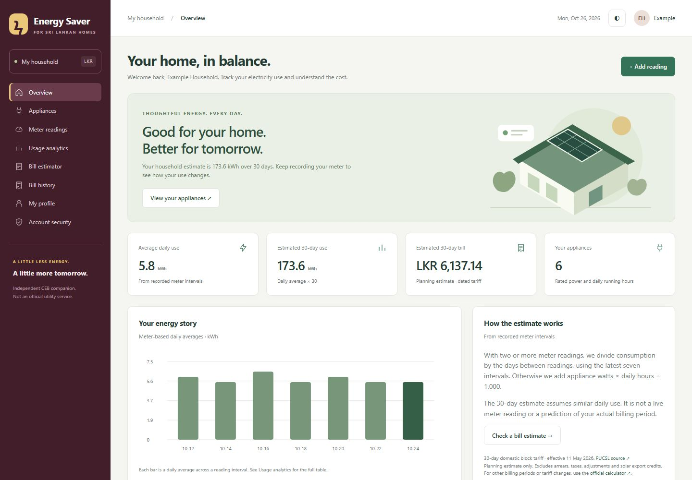
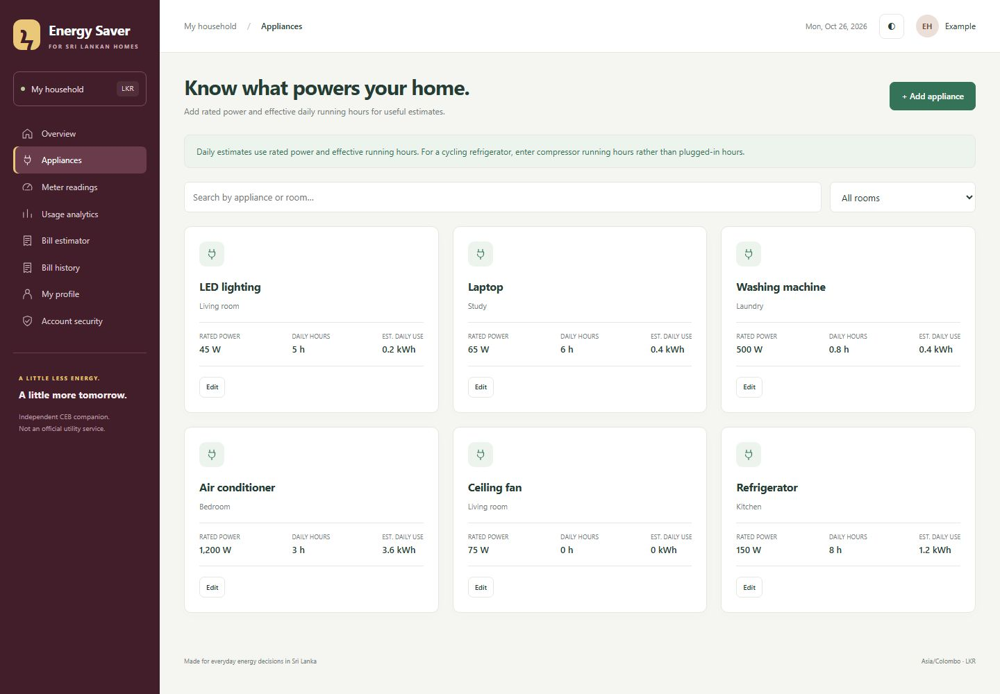
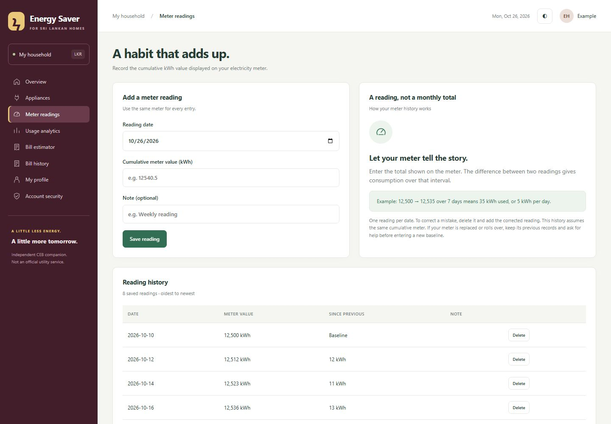
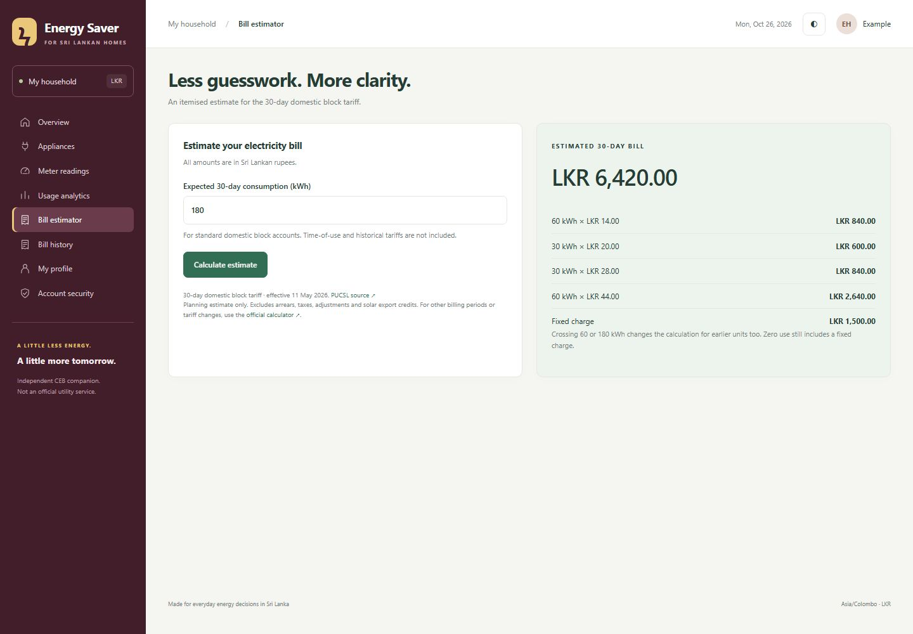
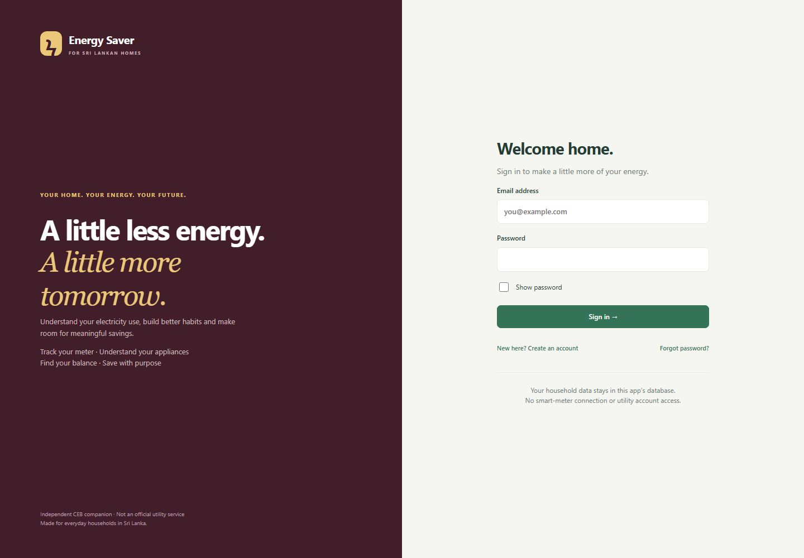
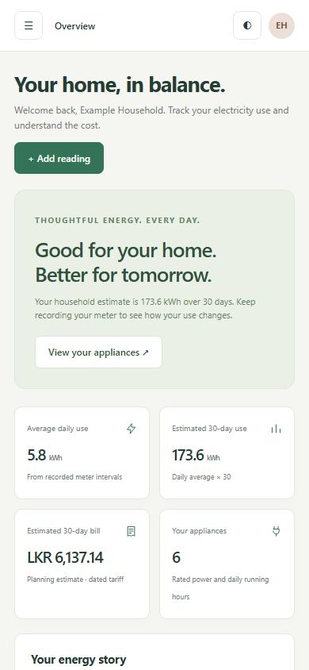
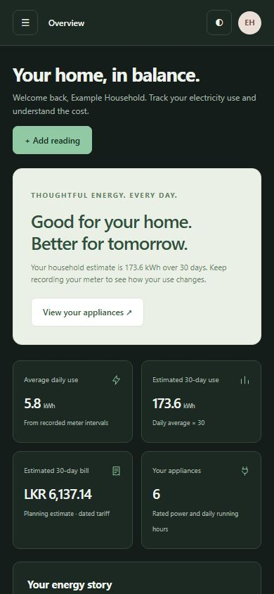

# CEB Energy Saver

A household electricity tracker for Sri Lanka, built with HTML, CSS, JavaScript, Express and SQLite. Add appliances, record cumulative meter readings, and compare estimated electricity costs with saved bills. This is an independent student project, not an official CEB service.

## Features

- Register, sign in, sign out, change your password and recover access with a saved code.
- Add, edit, search and delete household appliances with rated power and daily running hours.
- Record dated meter readings with duplicate and chronological checks.
- View consumption charts and daily/30-day estimates, with their source explained.
- Calculate an itemised bill estimate and save actual monthly bills for comparison.
- Edit your name/email and use the responsive interface in light or dark mode.

## Run with Docker Desktop

Use Linux containers. From this folder:

```powershell
docker compose up --build -d --wait
```

Open **http://localhost:3002**, or double-click `start-docker.cmd`. The launcher opens the actual published Docker port. Register your own account; there is no default login. Save the recovery code displayed during registration.

```powershell
docker compose logs -f app
docker compose stop
docker compose up -d --wait
```

SQLite data stays in the `household-data` volume when the container is rebuilt or removed. **Do not run `docker compose down -v`: it deletes that volume.** Set `CEB_PORT` to another free host port if 3002 is occupied.

## Run without Docker

Install Node.js 22 or newer, then:

```powershell
cd backend
npm ci
npm start
```

Open **http://localhost:3000**. Windows users can then use `start.cmd`. There is one server for the pages and API, and no separate frontend compilation step. Optional configuration is documented in `backend/.env.example`; the default database is `backend/database.sqlite`.

## Understand the code

| Folder or file                                | Responsibility                                                    |
| --------------------------------------------- | ----------------------------------------------------------------- |
| `frontend/index.html`, `login.html`           | Page shells and script/style loading                              |
| `frontend/views.js`, `bills.js`, `account.js` | Render the eight screens using the signed-in household data       |
| `frontend/app.js`, `auth.js`, `common.js`     | Navigation, forms, API requests and shared UI helpers             |
| `frontend/energy.js`                          | Pure tariff, appliance and meter calculations, also used by tests |
| `backend/server.js`                           | Validate requests and handle household CRUD routes                |
| `backend/auth.js`                             | Password hashing, cookie sessions, CSRF and recovery              |
| `backend/db.js`, `validation.js`              | SQLite queries/transactions, safe migrations and input checks     |
| `backend/test/`                               | Calculation, API, migration and optional browser tests            |
| `docs/screenshots/`                           | Current portfolio screenshots made with sample data               |

**Application flow:** a form in the browser calls `api()` in `common.js`. Express authenticates the session and validates the input. A parameterised SQLite query reads or saves only that user's records. The API returns JSON and `app.js` renders the updated screen. Bill estimates are calculated in `energy.js` in the browser; saved bill amounts are entered from actual bills.

**Demo:** create an account → add an appliance → add two meter readings on different dates → inspect Usage analytics → calculate a bill → save an actual bill in Bill history. Be ready to explain one appliance request from the form through the API to SQLite.

## Calculation scope and data safety

Appliance use is watts × effective daily hours ÷ 1,000. Meter consumption is the difference between cumulative readings. The overview uses a day-weighted average of the latest seven intervals, or appliance estimates until two readings exist, then multiplies by 30.

The bill model is a **dated 30-day domestic tariff snapshot effective 11 May 2026**, with tested block boundaries and fixed charges. It is not a current tariff feed. See the source link in the estimator and use the official calculator for other periods or tariff revisions. Estimates exclude taxes, arrears and other adjustments. No smart-meter or utility account integration is connected.

Existing databases are upgraded without dropping tables, columns or records. Older unused records remain in the database; new databases create only the six tables needed by this version. Keep the database and `.env` out of Git. For a backup, stop the app and copy its database plus any remaining WAL/SHM sidecars together; keep Docker volume backups outside this repository.

Passwords use bcrypt. Session credentials use HttpOnly/SameSite cookies and hashed database tokens. CSRF checks, rate limits, expiry, user-scoped SQL, transactions and strict browser security headers remain in place. Public deployment requires an HTTPS reverse proxy plus `NODE_ENV=production` and an HTTPS `APP_ORIGIN`; the supplied Docker setup is for local HTTP use.

## Verify

```powershell
node --test backend/test/app.test.js backend/test/migration.test.js
docker build --target test -t ceb-energy-saver:test .
docker run --rm ceb-energy-saver:test
```

The tests use memory or disposable databases, including a migration/restart test that preserves older records. `docker compose build` is the production image build.

For the optional browser suite, install its test-only tool without changing the app manifest or lockfile:

```powershell
cd backend
npm install --no-save --package-lock=false playwright
npx playwright install chromium
npm run test:browser
```

Alternatively, point `PLAYWRIGHT_MODULE_PATH` at a separate Playwright installation; `BROWSER_CHANNEL=msedge` uses installed Edge. It checks the full user journey, all eight screens at desktop/mobile sizes, HTML escaping, password changes and browser errors. Set `UPDATE_SCREENSHOTS=1` to refresh the seven images below; otherwise captures go to ignored `artifacts/`.

## Screenshots

Current browser captures use a temporary example household, not real account details. Use the overview as a portfolio cover and appliances, the bill estimate and mobile views to explain the project.



| Appliances                                                       | Meter readings                                                           |
| ---------------------------------------------------------------- | ------------------------------------------------------------------------ |
|  |  |

| Bill estimator                                                            | Sign in                                                 |
| ------------------------------------------------------------------------- | ------------------------------------------------------- |
|  |  |

| Mobile light                                                                                       | Mobile dark                                                                                            |
| -------------------------------------------------------------------------------------------------- | ------------------------------------------------------------------------------------------------------ |
|  |  |
